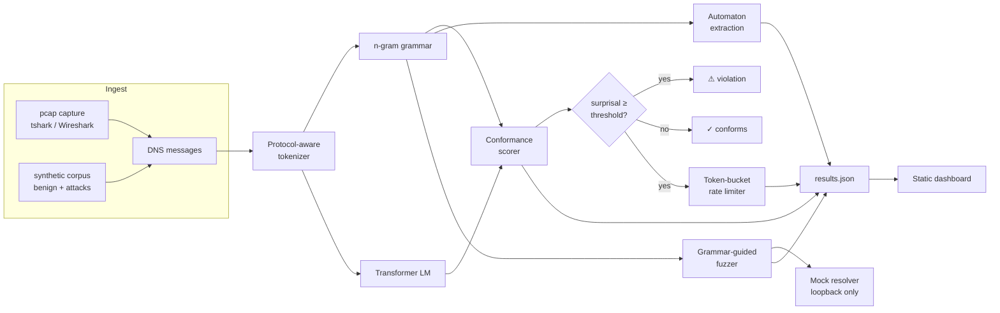

<div align="center">



# Syntactica

### Neural protocol grammar for DNS — learn the rules, catch what breaks them, fuzz for what breaks the parser

[](https://github.com/cattolatte/syntactica/actions/workflows/ci.yml)
[](https://www.python.org/)
[](LICENSE)
[](https://cattolatte.github.io/syntactica/)
[](tests/)

*Every protocol is a grammar. Syntactica learns the grammar of benign DNS traffic, flags anything improbable under it — tunnelling, DGA, malformed packets — and turns the same grammar around to fuzz a resolver.*

</div>

---

## Why this exists

Most machine-learning intrusion detectors are **supervised classifiers** trained on a labelled attack dataset. They inherit two problems: they need attack labels (so they cannot catch what they have never seen), and they report a single inflated accuracy number on one benchmark.

Syntactica takes the opposite stance, grounded in a simple observation from computer networks: **a protocol is a formal language.** A DNS message has a grammar — a header structure and a name syntax — exactly the way Forouzan draws it. If you learn that grammar from *normal* traffic with a language model, then a message the model finds improbable is, by construction, a message that breaks the rules. No attack labels required, and zero-day families are caught the same way as known ones.

Three capabilities fall out of one learned grammar:

| | Capability | How |
|---|---|---|
| 🛡️ | **Detect** | A language model scores per-token surprisal; a benign-calibrated threshold flags violations. |
| 🔍 | **Explain** | An interpretable automaton is extracted, and per-token surprisal points at the exact byte that broke the grammar. |
| 🧭 | **Guarantee** | Split-conformal calibration gives a *distribution-free* bound on the false-positive rate — pick your α, the FPR provably stays ≤ α. |
| 🚦 | **Respond** | A per-source **token bucket** (Unit IV) throttles abusive sources, preserving legitimate goodput — detection becomes defence. |
| ✅ | **Verify** | Hand-rolled **CRC-32 + Internet/UDP checksum** (Unit II) check the integrity of captured packets. |
| 🔄 | **Self-learn** | An **online** detector keeps learning from the live stream and adapts to traffic drift, so it stops false-alarming on benign novelty — with a repetition gate so an attack flood can't poison it. |
| ⚔️ | **Fuzz** | Sampling the grammar at temperature generates valid-but-mutated queries to probe a resolver's parser. |

Together these form a self-contained **autonomic (MAPE-K) loop** — Monitor DNS, Analyse with the grammar, Plan a response, Execute via the token bucket, and update per-source Knowledge — an "agentic" control loop that needs no external LLM and runs entirely offline. (On why there is *no* LLM agent, see [Design notes](#why-no-llm-agent).)

## Results (synthetic benchmark, one seed)

| Model | ROC-AUC | PR-AUC | Attack recall | False-positive rate |
|---|:---:|:---:|:---:|:---:|
| Interpolated n-gram grammar | **0.9999** | 0.9999 | 100 % | 2.6 % |
| Causal Transformer LM | 0.976 | 0.983 | 91.3 % | 3.5 % |

Per-family detection at the benign-calibrated operating point: **tunnelling 100 %, DGA 100 %, malformed 100 %**, with a 2.6 % benign false-alarm rate. The detector is calibrated on benign traffic only; **no attack labels are used to fit it.**

> **Reading these numbers honestly.** Two things are worth calling out. (1) The synthetic attack families are statistically distinct from benign traffic *by construction*, so high separability is expected — the contribution is the **unsupervised, zero-day-capable framing**, the **interpretability**, and a pipeline that runs on **your own captures**, not the AUC itself. (2) The compact n-gram grammar **out-performs the small Transformer** here. That is not a bug: on short, highly-structured protocol sequences a well-smoothed n-gram is a very strong model, and the right inductive bias beats raw capacity. The Transformer earns its place as the model that *scales* to richer protocols and longer-range structure; on DNS name shape, the trigram is hard to beat. See [Limitations](#limitations).

**Distribution-free operating points (conformal).** Calibrated on held-out benign traffic, the realised false-positive rate stays at or below the target α at every level, while recall stays high:

| target α (max FPR) | empirical FPR | attack recall |
|:---:|:---:|:---:|
| 0.5 % | 0.13 % | 97.5 % |
| 1.0 % | 0.50 % | 99.1 % |
| 2.0 % | 1.19 % | 99.6 % |

**Closed-loop defence (token bucket, Unit IV).** One exfil channel floods twelve legitimate clients. The detector-driven adaptive limiter preserves *all* legitimate traffic **and** blocks the attack — something a naive global rate cap cannot do:

| Policy | Legitimate goodput | Attack blocked |
|---|:---:|:---:|
| No mitigation | 100 % | 0 % |
| Naive global rate cap | 72 % | 27 % |
| **Adaptive (detector-driven)** | **100 %** | **98 %** |

**Online self-learning under drift.** When benign traffic shifts (a new internal service appears), a *frozen* detector false-alarms on almost all of it. The online detector keeps learning and adapts — while still catching attacks:

| Detector | False alarms after drift | Attack recall |
|---|:---:|:---:|
| Static (frozen) | **97 %** | 100 % |
| **Online (self-learning)** | **0.1 %** | 92 % (tunnel 100 %, DGA 84 %) |

The same grammar, used offensively, reproduces the validity/novelty tradeoff of grammar-guided fuzzing: as sampling temperature rises from 0.5 → 2.0, generated queries drift from the learned grammar (mean novelty **1.12 → 2.56 nats/token**) while remaining largely wire-valid.

**→ Explore it all in the [live dashboard](https://cattolatte.github.io/syntactica/)** (score any domain in your browser, watch the token bucket defend goodput, and see the Transformer's learned embedding space).

## Architecture



This is a closed **MAPE-K** control loop: **M**onitor (ingest) → **A**nalyse (grammar scorer) → **P**lan/**E**xecute (token bucket) → **K**nowledge (per-source buckets), so the system is a self-contained autonomic agent.

Every message becomes a token stream that exposes protocol structure rather than raw bytes:

```
<bos> QR=0 OP=QUERY QT=A QC=1
      LEN=m  w w w        <sep>
      LEN=l  e x a m p l e <sep>
      LEN=s  c o m          <sep>
<root> <eos>
```

The `LEN=` tokens make the *shape* of a name first-class: benign names walk short dictionary lengths, DNS tunnelling explodes into `LEN=xxl` runs, and malformed control bytes emit an `<oovc>` token the grammar has never seen. That is why the detector's decisions are explainable in protocol terms.

## Quickstart

```bash
git clone https://github.com/cattolatte/syntactica.git
cd syntactica
pip install -e ".[nn,dev]"     # drop [nn] to skip PyTorch; the n-gram grammar still runs

# 1. Reproduce every figure and metric from a single seed
syntactica report

# 2. Score domains from the command line
syntactica score www.google.com k\q3v9xzmbnrtplahsyw.com \
                 mfrggzdfmztwq2lk.tunnel.example.com

# 3. Analyse a REAL capture from your own network (see below)
syntactica analyze mycapture.pcap

# 4. Grammar-guided fuzzing against the bundled loopback mock resolver
syntactica fuzz -n 500 --temperature 1.3

# 5. Open the dashboard
cd dashboard && python -m http.server 8000   # visit http://localhost:8000
```

Everything runs on a CPU in well under a minute. The Transformer trains in seconds.

### Run it live on your own network

<div align="center">



</div>

The dashboard on GitHub Pages is the **report** — the system itself runs locally on your machine and your traffic. **Wireshark** is the capture front end:

```bash
# Option A — Wireshark CLI (tshark), via the bundled helper:
scripts/capture.sh en0 500 mycapture.pcap

# Option B — Wireshark GUI: set the capture filter to  udp port 53 , capture,
# then File → Save As. (pcap OR pcapng — the reader accepts both.)

# Then learn the grammar of YOUR traffic and flag its anomalies + checksum errors:
syntactica analyze mycapture.pcap
```

`analyze` fits the grammar on the capture's own (mostly-benign) traffic, then surfaces the least-conforming queries and any UDP-checksum failures — the deploy-on-your-network workflow, with no labels required. The reader ingests both classic **`.pcap`** and **pcapng** (Wireshark's default) and the DNS codec is pure Python with **zero external dependencies**.

## Project layout

```
syntactica/
├── src/syntactica/
│   ├── data/          # DNS wire codec, schema, synthetic corpora, pcap reader
│   ├── tokenizer.py   # protocol-aware tokenization (the grammar's front end)
│   ├── models/        # n-gram grammar (numpy) + Transformer LM (torch, optional)
│   ├── conformance.py # surprisal scoring, calibration (quantile + conformal)
│   ├── online.py      # online self-learning detector (drift adaptation)
│   ├── grammar/       # automaton extraction + field-level localisation
│   ├── net/           # CRC-32 + Internet/UDP checksum (Unit II error detection)
│   ├── mitigation/    # token bucket + adaptive rate limiter (Unit IV) + sim
│   ├── fuzz/          # grammar-guided generator + safe loopback harness
│   ├── eval.py        # ROC/PR, per-family recall, score distributions
│   ├── cli.py         # report / score / analyze / fuzz / demo
│   └── report.py      # end-to-end pipeline → dashboard artefacts
├── dashboard/         # self-contained static dashboard (GitHub Pages)
├── docs/adr/          # architecture decision records
└── tests/             # 42 tests: codec, detection, checksum, mitigation, online, fuzzing safety
```

## Attack families modelled

- **DNS tunnelling / exfiltration** — long, high-entropy base32 labels under a fixed base domain; the classic covert channel.
- **Domain generation algorithms (DGA)** — unpronounceable algorithmically-generated domains (Conficker/Cryptolocker signature).
- **Malformed / protocol-violating** — control characters, reserved query types, over-long labels, queries that carry answers.

## Limitations

- **Synthetic separability is high by design.** The synthetic generator models the *coarse* statistics of DNS; real traffic is messier and harder. Treat the AUC as an upper bound and validate on your own captures.
- **Scope is DNS.** The grammar-as-language thesis generalises (HTTP, TLS, Modbus), but depth on one protocol beats breadth. DNS was chosen for its rich attack surface and clean structure.
- **The extracted automaton models name *shape*, not full semantics.** It is an interpretable corroborating signal, not a complete protocol state machine.
- **The fuzzer targets a mock resolver by default and refuses non-loopback targets** unless explicitly authorised — see the [threat model](docs/threat-model.md).
- **Pronounceable/dictionary DGAs are harder.** The synthetic DGA is high-entropy; adversaries that mimic the benign grammar (dictionary DGAs, mimicry attacks) are out of scope and left as future work.

## Why no LLM agent?

A common way to make a project *look* advanced is to bolt a large-language-model "agent" onto it. We deliberately did **not**, and the reasons are worth stating:

- **It would break the core promise.** This is a networking system that must run **locally, offline, on your own traffic**. An LLM agent needs an external API — cost, latency, and a network dependency at the exact layer we are trying to defend.
- **It would break reproducibility.** Every figure here regenerates deterministically from one seed. An LLM in the loop is non-deterministic and unversioned.
- **It adds no networking substance.** The hard, defensible parts of this project are the protocol grammar, the token-bucket response, and the conformal guarantee — none of which an LLM improves.

Instead, the "agentic" property is delivered the way autonomic systems have done it for two decades: a **self-contained MAPE-K control loop** (see [Architecture](#architecture)) that monitors, analyses, plans, executes and remembers — with zero external services. That is the right kind of autonomy for a network defence.

## Documentation

- [Architecture](docs/architecture.md) · [Threat model](docs/threat-model.md) · [Course mapping (CN PBL)](docs/course-mapping.md)
- [Architecture Decision Records](docs/adr/) — why n-gram *and* Transformer, why perplexity, why a static dashboard, and more.

## References

- Lin et al., *ET-BERT: A Contextualized Datagram Representation for Encrypted Traffic Classification*, WWW 2022.
- Godefroid, Peleg, Singh, *Learn&Fuzz: Machine Learning for Input Fuzzing*, ASE 2017.
- Ye et al., *NetPlier: Probabilistic Network Protocol Reverse Engineering*, NDSS 2021.
- Weiss, Goldberg, Yahav, *Extracting Automata from Recurrent Neural Networks*, ICML 2018.
- Angelopoulos & Bates, *A Gentle Introduction to Conformal Prediction*, 2021.
- Kephart & Chess, *The Vision of Autonomic Computing* (MAPE-K), IEEE Computer 2003.
- Forouzan, *Data Communications and Networking* — Unit II (CRC), Unit IV (token bucket).

## License

MIT — see [LICENSE](LICENSE).
